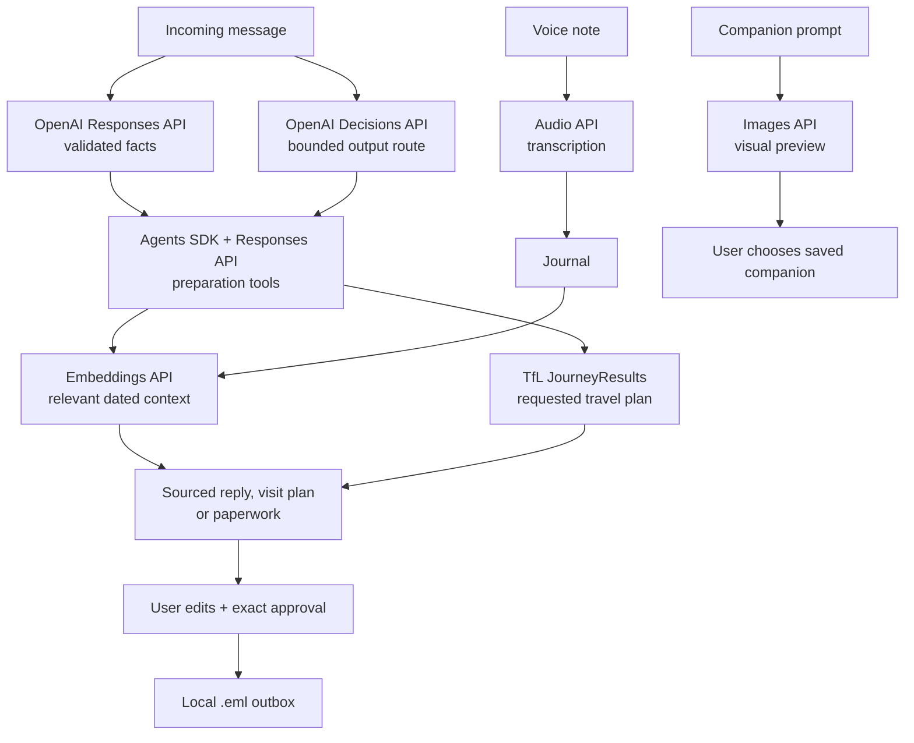

# Pocket Ally

**A little less to carry.**

A phone-first companion for adults living with cancer and their partners. Turn daily notes and incoming messages into sourced replies, visit plans and paperwork. You control what is shared.

*Built at DevDay Exchange London with Codex. Synthetic UK demo; approved messages stay in a local outbox.*

## A look inside

| Home | Tasks | Journal |
|---|---|---|
|  |  |  |

| Companion | Demo |
|---|---|
|  |  |

Screens captured from isolated synthetic data.

## How it works

- Record or write everyday observations, keeping the original audio and editable text.
- Submit an incoming message. Pocket Ally finds relevant dated notes and prepares a supported result, or asks for missing information.
- Inspect sources, edit the draft and approve the exact version saved to the local outbox.



The model has no approval or send tools. Sources remain reviewable, and editing invalidates prior approval.

## Quickstart

Requires Python 3.12. Run from the repository root:

```bash
python3.12 -m venv .venv
source .venv/bin/activate
pip install -r requirements.lock
cp -n .env.example .env
uvicorn app.main:app --host 127.0.0.1 --port 8000
```

Open [localhost:8000](http://127.0.0.1:8000). Without keys, fallbacks are labelled; configure `.env` to enable OpenAI features. Email stays local with `APP_MODE=local`.

[Technical setup, APIs and safety](docs/TECHNICAL.md) · [Demo guide](docs/DEMO.md) · [Submission](docs/SUBMISSION.md) · [Codex build evidence](CODEX.md) · [Credits](CREDITS.md)
