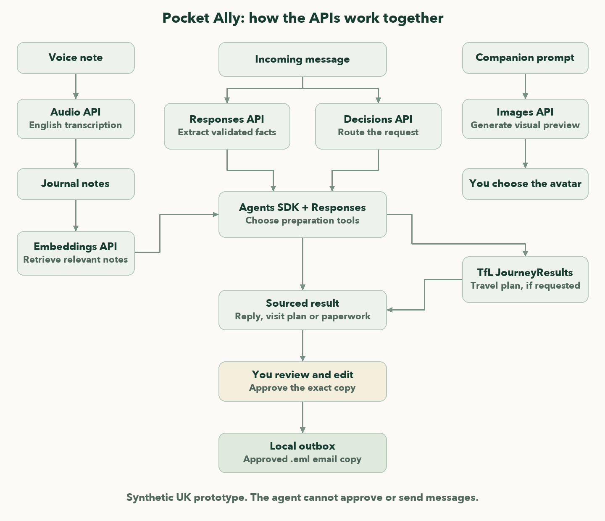

# Pocket Ally

**A little less to carry.**

A phone-first companion for adults living with cancer and their partners. Turn daily notes and incoming messages into sourced replies, visit plans and paperwork. You control what is shared.

*Built at DevDay Exchange London with Codex. Synthetic UK demo; approved messages stay in a local outbox.*

## A look inside

| Home | Tasks | Journal |
|---|---|---|
|  |  |  |

| Companion | Demo |
|---|---|
|  |  |

Screens captured from isolated synthetic data.

## How it works

- Record or write everyday observations, keeping the original audio and editable text.
- Submit an incoming message. Pocket Ally finds relevant dated notes and prepares a supported result, or asks for missing information.
- Inspect sources, edit the draft and approve the exact version saved to the local outbox.



The model has no approval or send tools. Sources remain reviewable, and editing invalidates prior approval.

## Capabilities and fallbacks

| API | Used for | Without it |
|---|---|---|
| Decisions API | Bounded output routing | Validated source routing |
| Responses API + Agents SDK | Fact extraction, agent reasoning and tool calls | Labelled parsing and scripted preparation |
| Audio API | English voice transcription; original audio retained | Saved recording and typed transcript |
| Embeddings API | Relevant dated journal notes | Labelled keyword/topic matching |
| Images API | Companion previews | Labelled local style preview |
| TfL JourneyResults | Requested journey plans | Explicitly unavailable route or unverified estimate |

OpenAI features can run while email stays local. See the [provider and fallback guide](docs/TECHNICAL.md#what-is-real-and-what-is-a-fallback) for configuration and limits.

## Privacy and approval

Use synthetic data only; the prototype provides no clinical advice. Enabled OpenAI features process relevant messages, notes, recordings or image prompts. Approval binds the exact recipient, subject, body and attachments; edits require new review, only configured throwaway recipients are allowed, and NHS addresses are blocked. [Safety details](docs/TECHNICAL.md#safety-and-source-fidelity).

## Private phone access

Install the PWA from private HTTPS using the browser's Add to Home Screen action. Access requires the configured host and a verified Tailscale identity or access session; only the public offline shell and packaged artwork are cached, never journal entries or API responses. [Phone setup](docs/TECHNICAL.md#private-phone-access-and-install).

## Build and verification

Built by one human with Codex, using tested tools and isolated synthetic provider checks. Automated checks cover source handling, replay safety and approvals; browser verification covers sourced replies, edits and local outbox copies. See [build evidence](CODEX.md) and the [architecture](docs/TECHNICAL.md#architecture).

## Quickstart

Requires Python 3.12. Run from the repository root:

```bash
python3.12 -m venv .venv
source .venv/bin/activate
pip install -r requirements.lock
cp -n .env.example .env
uvicorn app.main:app --host 127.0.0.1 --port 8000
```

Open [localhost:8000](http://127.0.0.1:8000). Without keys, fallbacks are labelled; configure `.env` to enable OpenAI features. Email stays local with `APP_MODE=local`.

[Technical setup, APIs and safety](docs/TECHNICAL.md) · [Demo guide](docs/DEMO.md) · [Submission](docs/SUBMISSION.md) · [Codex build evidence](CODEX.md) · [Credits](CREDITS.md)
