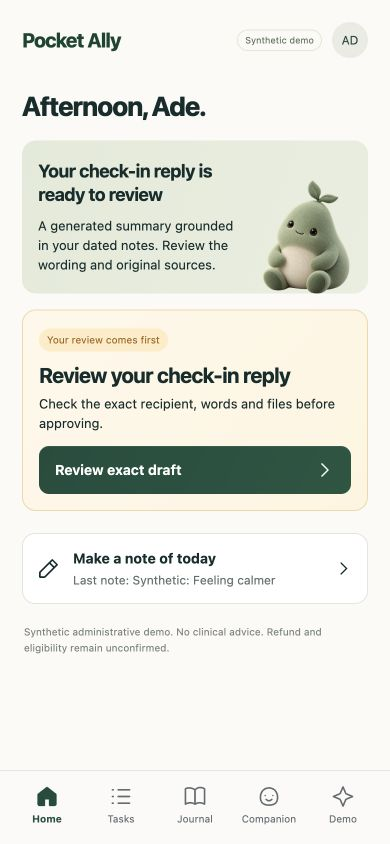
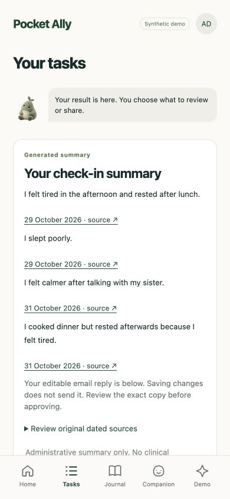
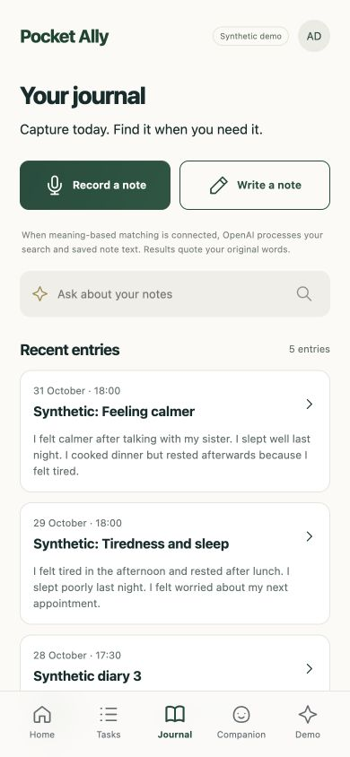
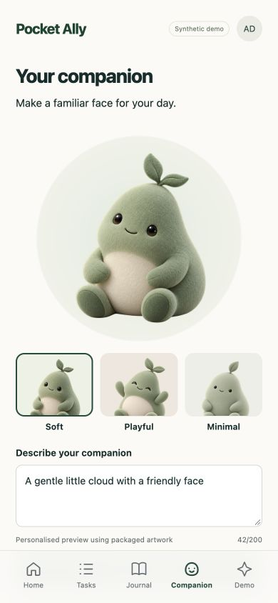
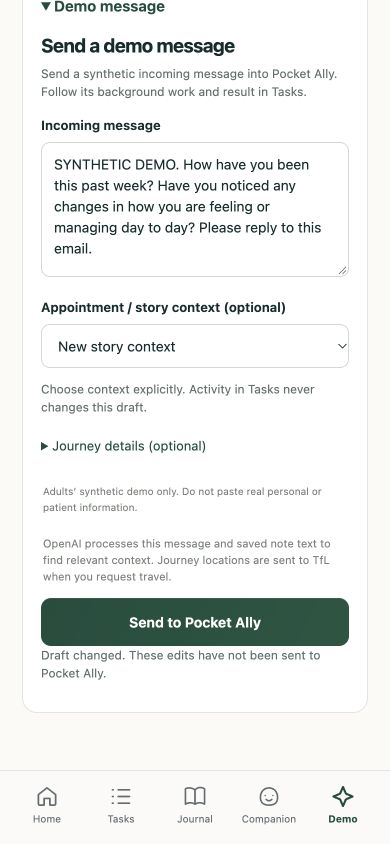

# Pocket Ally

Pocket Ally is a phone-first companion for adults living with cancer and the partners supporting them.

**A little less to carry.** Everyday journal notes and incoming messages help prepare sourced wellbeing replies, visit plans and paperwork. Pocket Ally automatically finds relevant dated context, keeps the original notes available and lets people edit and review the exact words before approving sharing.

The current build is a synthetic UK prototype using fictional data. Approved demo emails are saved as local outbox copies; external email delivery is not demonstrated.

Built during the DevDay Exchange London Community Hackathon, 1 November 2026. Solo project with Codex. No clinical advice, symptom interpretation, benefits calculation or real patient data.

## A look inside

Current mobile screens, captured from an isolated synthetic store. The check-in is prepared for review; no message has been delivered.

| Home | Tasks | Journal |
|---|---|---|
|  |  |  |
| The next decision and a direct route to review the exact draft. | Prepared results lead with dated evidence. The editable reply and exact approval controls follow below. | Record or write a note, find saved observations and keep their original wording available. |

| Companion | Demo |
|---|---|
|  |  |
| A packaged Soft style is shown here. Preview a character, then explicitly choose the version to save. | Edit synthetic incoming messages and choose visit or journey context independently of Tasks. **Send to Pocket Ally** starts app preparation, not external email delivery. |

## Run locally

Requires Python 3.12. All example data is synthetic. The default works without API keys, Google OAuth or a database server.

```bash
python3.12 -m venv .venv
source .venv/bin/activate
pip install -r requirements.lock
cp -n .env.example .env      # preserve existing credentials
python scripts/smoke.py       # missing credentials are expected in local mode
python -m pytest -q
uvicorn app.main:app --host 127.0.0.1 --port 8000
```

Open [the local app](http://127.0.0.1:8000). Home summarises the current situation and next decision. In Demo, generate or edit a synthetic message, choose a new or existing visit, and add journey details. **Send to Pocket Ally** submits the synthetic incoming message and keeps you in Demo with an optional View activity link. Tasks independently shows progress, results and the next action. Demo owns its draft and selected appointment context; task refreshes do not overwrite or retarget it. An explicit follow-up action can bring task context into Demo while protecting an unrelated draft. Source details stay available on request. Journal offers recording, writing, history and cited recall. Companion lets you describe a character, preview a style and explicitly choose the saved result.

`requirements.lock` pins the verified application and test dependencies; `requirements.txt` records allowed version ranges. [CODEX.md](CODEX.md) records actual test, browser and provider verification. The server allows loopback by default; optional private phone access requires one exact hostname plus a verified private Tailscale identity or access session.

### What is real, and what is a fallback?

| Feature | Default `APP_MODE=local` | Optional `APP_MODE=live` |
|---|---|---|
| Inbox | Synthetic forwarded email from `fixtures/attendance.txt` | Polls Gmail for a UCLH + SYNTHETIC subject |
| Editable message extraction | Responses API when a key is present; labelled text parser otherwise | Same quote-validated extraction |
| Bounded output routing | Decisions API with `gpt-6-luna` when a key is present; recorded source-routing fallback otherwise | Same constrained routing; no approval or send authority |
| Calendar | Downloadable `.ics`; **not** added to Google | Creates an event using Google Calendar |
| Claim | Actual NHSBSA June 2025 HC5(T), partially filled with pypdf | Same PDF preparation |
| Email | Approved `.eml` files in ignored `data/outbox` | Approved messages to exact throwaway test addresses |
| Case context and Journal recall | `text-embedding-3-small` when a key is present; labelled keyword/topic matching otherwise | Same cited retrieval, with SQLite embedding cache |
| Journey planning | Fresh TfL JourneyResults request for supplied postcodes and arrival time | Same TfL adapter |
| Original diary workflow | Fixture recordings and transcripts in SQLite | Transcription and optional Postgres + pgvector |
| Original preparation | Ordered Python workflow | Agents SDK + GPT-5-class Responses model calls the safe preparation tools |
| Event-driven cases | Agents SDK when a key is present; labelled scripted fallback otherwise | Same interpreter; exact approvals still required |

Message extraction, Decisions routing, the event-driven case agent, semantic retrieval, Journal transcription and Companion previews use `OPENAI_API_KEY` independently of `APP_MODE`. This lets interpretation, voice and image features work while email and calendar stay safely local. Without a key, cases use an explicitly labelled scripted fallback, recordings remain available with a clearly pending transcript and a typed fallback, and Companion provides a labelled local style preview. A failed agent run remains an error that can be retried; it does not silently become a scripted success. Other provider failures preserve the recording or offer an honestly labelled local image preview.

Journal recordings are limited to two minutes and 10 MiB, with supported WebM, MP4, WAV and Ogg containers. Transcription explicitly requests English; the saved audio and editable transcript remain available for correction. Browser microphone support and permission vary; writing remains available. Journal storage stays separate, while cases automatically retrieve relevant dated observations by event time and topic. Context cards show the source and reason. Optional manual links are not a prerequisite for this retrieval and never approve external sharing. Recall quotes matching source sentences with dated links and adds no new facts.

### Editable messages and replayable cases

The separate Demo tab offers editable examples for check-in, confirmed visit, attended visit and reschedule. Examples populate visible text; hidden preset dates and labels do not override edits. Optional journey fields accept full UK postcodes, and an existing visit can be explicitly selected for an update. **Send to Pocket Ally** starts the event in the background while leaving the Demo editor open. This is an incoming demo event, not an email delivery. Tasks contains progress, outcomes and approvals; generation and message inputs stay in Demo. Progress reflects the real running state and completed preparation steps. Results come first: review your observations, view the appointment plan, add a missing receipt or approve an exact draft. Source messages, dated context and recorded decisions are available in optional details. With a key, the Responses API extracts facts from the actual message. The server validates exact source quotes and requires a complete date and time. Unclear input produces a missing-detail action. A bounded Decisions API request classifies the incoming message into reply draft, visit summary, appointment update or clarification. Accepted check-in routes control whether the result becomes a draft or an internal summary. Validated source facts and explicit no-reply instructions take precedence; uncertain, incompatible or unavailable decisions retain a recorded source-routing fallback. The bounded Agents SDK interpreter then reads the message, searches relevant notes and chooses preparation tools from its content. It has no send or approval tool.

**Generate next message** uses the Responses API to write a synthetic incoming message from the selected situation and bounded visit facts. Generation excludes journal text and recordings, performs no task actions and leaves the message visible for editing before sending it to Pocket Ally. A reschedule includes the known prior date and a proposed synthetic date two days later; both remain editable. A future visit cannot be turned into completed attendance. Generated dates, location, intent and receipt claims are validated against the supplied context. Provider failures remain explicit, with manual writing still available.

Check-ins use the existing task agent to compose short sentences from relevant retrieved notes, retaining dated citations and the original sources for review. Retrieval follows the actual question. Activity notes alone do not answer a general question about how someone has felt: the app identifies that partial coverage and asks for the missing observation in Journal without inventing a reply. Explicit activity questions can still use those notes. The coverage guard is conservative, and the user must review the result. An email asking for a reply produces a check-in reply draft; an explicit request to bring an update to a visit stays internal. Reply drafts can be edited, saved and then reviewed through the exact approval control. Saving creates a new digest and invalidates the previous approval; saving never sends. Offline runs are labelled as original source extracts rather than generated synthesis.

A fingerprint of the message, journey fields and visit target keeps repeated submissions on the same case. A completed event opens its latest saved result without new model calls, duplicate effects or simulated replay animation. Context is a dated snapshot of that run: later notes do not silently rewrite it, while a distinct edited follow-up retrieves context again. If no relevant notes are available, the next action opens Journal; after adding observations, send an edited follow-up to prepare a new update. An attended visit pauses for its missing receipt; adding the labelled synthetic receipt resumes that case. A reschedule requires an explicitly selected existing confirmed visit; an unassigned change asks which visit to update and creates no second plan. Valid changes update the same appointment plan and require renewed review of superseded pending drafts. Already delivered records are preserved. The case calendar export is a local planning file, not a Google Calendar booking.

Semantic retrieval ranks up to the 32 most recent eligible dated sources using real cosine similarity, embedding at most 2,000 characters per note. Its content-addressed SQLite cache changes when source text changes. Results retain original dated source links; a relevance threshold can return no match. A provider failure is labelled separately and may show keyword/topic fallback results. The current bounded search is not a complete archive search.

Requested travel uses the fixed TfL JourneyResults endpoint, supplied postcodes and appointment arrival time. Returned options retain their query, source and check time. The selected departure updates the same local calendar UID. Future-date results are freshly fetched plans, not live departure predictions, fares or accessibility guarantees. If TfL is unavailable, the interface says so; any remaining calendar travel buffer is an explicitly labelled estimate. OpenAI processes the message and saved note text to find relevant context, and TfL receives journey locations. These requests do not send an email or approve sharing.

Companion has Soft, Playful and Minimal packaged styles. With a key, a new preview uses the Images API. `OPENAI_IMAGE_MODEL` defaults to the supported `gpt-image-1-mini` for low-cost, low-latency transparent previews; it is configurable and is not advertised as the newest image model. Previewing never replaces the saved companion until **Choose this companion** is selected.

## Private phone access and install

Use a private HTTPS reverse proxy such as Tailscale Serve, leaving Uvicorn bound to `127.0.0.1`. Configure `PUBLIC_DEMO_HOST` as the exact HTTPS hostname and `DEMO_ACCESS_TOKEN` as a long random secret in ignored `.env`. The phone must have access to the private network. Open `https://<configured-host>/access/<token>` once. The server creates a Secure, HttpOnly, SameSite session cookie and redirects to the clean home URL. Treat this capability link as a secret and run Uvicorn with `--no-access-log`; the response disables caching and referrer forwarding. Fragment links using `/#access=<token>` also remain supported. Tokens are never stored in localStorage.

For private Tailscale Serve, optional `TAILSCALE_ALLOWED_LOGIN` can name the one permitted verified login. Run Uvicorn bound to `127.0.0.1` with `--no-proxy-headers --no-access-log`. In this mode the plain HTTPS home link works without browser cookies: authentication requires a raw loopback proxy connection, the exact configured actual and forwarded host, forwarded HTTPS, and the matching Serve identity. Enable this only behind private Serve, which strips supplied identity headers and inserts verified ones; do not use it with another proxy or public Funnel. [Tailscale identity-header documentation](https://tailscale.com/docs/features/tailscale-serve#identity-headers).

Remote API, audio, attachment and generated-image requests require either that verified identity or a valid session. Sessions expire after 12 hours and are revoked by a server restart; reopen the private access link if needed. Fragment links also work in an already-open page. A locked page offers a fragment-link or access-code field: it extracts the code on this device, clears the field on submission and exchanges only the code with this server. Mutations still require the same origin and the app's CSRF token. Forwarded requests cannot bypass this gate by claiming a localhost hostname. This is a single-builder synthetic demo, not multi-user authentication.

Use the phone browser's install or Add to Home Screen action. The manifest and root-scoped service worker provide an offline information screen. Only public static shell files and packaged artwork are cached. Journal entries, task data, attachments, generated images, sessions and mutations are never cached or replayed offline.

## Live configuration (optional; protect the deadline)

1. Create a throwaway Google Cloud project/account. Enable Gmail and Google Calendar APIs. Configure an OAuth consent screen with your throwaway account as a test user and create a Desktop OAuth client.
2. Save the client file as ignored `data/google-client.json`. Run `python scripts/google_auth.py` and sign in to the throwaway account. Scopes: Gmail read/send, Calendar events and Calendar list read.
3. Put `OPENAI_API_KEY`, `DATABASE_URL` and exact `TEST_UCLH_EMAIL`, `TEST_EMPLOYER_EMAIL`, `TEST_INBOX_EMAIL` values in `.env`. Never use actual NHS or employer addresses. Set `CONFIRM_THROWAWAY_ACCOUNTS=true` only for accounts you control. The NHS domain block is unconditional.
4. Start Postgres with the pgvector extension. An optional local container definition is provided in `compose.yaml`. Configure its password through `POSTGRES_PASSWORD` and the matching local `DATABASE_URL`.
5. Run `python scripts/smoke.py`. It makes a small Responses and embedding call, reads Gmail/Calendar metadata and checks vector SQL. It does not send mail or create events. All four must pass before switching `APP_MODE=live` and restarting.
6. Put the synthetic attendance email in the test inbox with UCLH and SYNTHETIC in the subject. Its plain-text body must contain the labelled fields from the fixture.
7. Use a fresh runtime directory between local and live rehearsals: stop the server and run `python scripts/reset_demo.py`. This preserves OAuth credentials while archiving synthetic run state.

`OPENAI_EXAMPLE_MODEL=gpt-6-luna` independently configures the short Demo message generator, using reasoning effort `none` and a 1,200-token output limit. `OPENAI_MODEL=gpt-5-mini` continues to configure extraction and task interpretation; verify account access in the smoke script. Google HTTP operations have bounded timeouts. No service failure silently becomes a success. An uncertain live send remains blocked until you inspect the test mailbox; do not blindly retry it.

## Safety and source fidelity

- Sending requires a **server-held approval bound to a SHA-256 digest** of recipient, subject, body, metadata and actual attachment bytes. The model cannot approve or send. The UI approval is protected by a same-origin token.
- Only exact configured test recipients can be used. NHS domains are blocked. Use only throwaway addresses you control; the software cannot verify a person's employment relationship.
- Calendar events have a stable ID. Local sends are idempotent. Live ambiguous delivery is held for manual inspection rather than automatically duplicated.
- Incoming email is data, never instructions. Editable extraction requires exact source quotes and rejects missing or ambiguous facts; the original inbox fixture parser additionally requires labelled fields. Employer text is a constrained template with a tested diagnosis/treatment/hospital word list.
- Original diary answers and Journal recall quote dated source wording. Case check-in summaries are generated drafts with validated retrieved source IDs and exact supporting evidence; original notes remain available. Conservative wording checks are not a guarantee of perfect semantic grounding, so the summary and exact reply remain reviewable before approval. These are not PIP assessments or complete forms.
- No bank-details input, database column or PDF fill is provided. The official PDF's bank fields remain blank. UCLH will ask directly. Do not add real bank information to diary fixtures.
- The £8.40 is an **invented receipt-based estimate**, not a TfL fare quote or guaranteed refund. A separate fare estimate remains `[estimate pending]`.
- The deadline uses **three calendar months from payment**, including month-end handling. It is an administrative reminder, not an eligibility decision.
- UCLH accepts claims by email or post and lists attendance, entitlement, travel evidence and its postal claim form. **HC5(T) alone is not a verified complete UCLH submission.** The synthetic pack is unsigned and visibly marked NOT FOR SUBMISSION. Date of birth, declarations, entitlement and UCLH form requirements remain pending review. See the [UCLH guidance](https://www.uclh.nhs.uk/patients-and-visitors/patient-information-pages/help-travel-costs).
- SQLite stores run state and the separate Journal table. Optional live task evidence additionally persists in Postgres with timestamps, audio paths and 1536-dimensional embeddings. Logs and generated files remain in ignored `data/`. SDK tracing is disabled. OpenAI receives enabled message, note, audio and image inputs even with local email/calendar mode. Extraction Responses requests use `store=False`. TfL receives only the supplied journey locations and planning parameters.

## Architecture

`app/examples.py` generates validated editable synthetic messages from bounded administrative context without creating effects. `app/incoming.py` fingerprints editable sources and validates Responses-extracted facts. `app/decisions.py` makes one bounded routing request on incoming text and constrains the result against validated facts. `app/retrieval.py` owns bounded semantic ranking and the SQLite embedding cache. `app/tfl.py` validates postcodes and queries the fixed TfL endpoint. `app/cases.py` owns the persisted event/visit registry, context retrieval and idempotent preparation. `app/case_agent.py` exposes bounded read, context and preparation tools to the Agents SDK. `app/synthesis.py` checks cited synthesis, routes reply versus internal output and replaces edited reply drafts with new approval-bound digests. `app/store.py` persists cases, drafts, digest-bound approvals and the audit trail. `app/tools.py` contains shared tested operations; `app/workflow.py` and `app/agent.py` retain the original preparation flow. `app/integrations.py` holds optional Google/OpenAI adapters; `app/vector.py` is the Postgres store. `config/trusts/uclh.yaml` holds submission channel, environment-based destination and evidence list.

`app/journal.py` handles separate journal storage, recording validation, transcription and source-extractive recall. `app/companion.py` persists previews and explicit selection. Neither module has send or approval authority. Pending product-copy migrations refresh only unsent, unapproved drafts with new attachment digests; delivered or approved payloads are not silently rewritten.

Only UCLH is supplied and verified. Adapter selection is configuration-based: add `config/trusts/<slug>.yaml` and set `TRUST_ID=<slug>`; the default is `uclh`. The loader rejects invalid identifiers, path escapes and unsupported evidence IDs. Supported evidence IDs are `attendance`, `entitlement`, `travel` and `claim_form`. The destination variable must resolve to an existing exact-allowlisted throwaway mailbox (the synthetic adapter can reuse `TEST_UCLH_EMAIL`); an adapter cannot bypass the send gate. A new trust's real submission rules and required forms still need independent verification.

The browser is buildless HTML/CSS/minimal JavaScript and uses system fonts without external requests. No frontend package manager is required. CSS was used instead of Tailwind CDN to keep the demo functional without external assets.

## Demo, submission and attribution

See [the demo guide and earlier recording](docs/DEMO.md), [submission checklist](docs/SUBMISSION.md), [Codex decisions and evidence](CODEX.md), and [credits](CREDITS.md). The saved video predates the PWA redesign and is historical. A current core-journey video and public submission links remain to be completed. Generated runtime files and credentials are ignored. Run `python scripts/release_check.py` before publishing.

The public GitHub repository and externally accessible demo-video URL must be added after publishing with your account. No public URL is claimed by this checkout.

## Official references checked on 1 November 2026

- [Codex](https://developers.openai.com/codex) and [quickstart](https://developers.openai.com/codex/quickstart)
- [OpenAI Agents SDK tools](https://openai.github.io/openai-agents-python/tools/)
- [OpenAI Decisions API](https://developers.openai.com/api/docs/guides/decisions)
- [OpenAI function calling](https://developers.openai.com/api/docs/guides/function-calling) and [Responses API](https://developers.openai.com/api/reference/resources/responses/methods/create)
- [TfL API schema](https://api.tfl.gov.uk/swagger/docs/v1) and [UCLH Macmillan Cancer Centre location](https://www.uclh.nhs.uk/our-services/our-hospitals/macmillan-cancer-centre)
- [Transcription](https://developers.openai.com/api/docs/guides/speech-to-text), [embeddings](https://developers.openai.com/api/docs/guides/embeddings), [Cookbook](https://developers.openai.com/cookbook)
- [Images API generation parameters](https://developers.openai.com/api/reference/python/resources/images/methods/generate)
- [Gmail sending](https://developers.google.com/workspace/gmail/api/guides/sending), [Calendar events](https://developers.google.com/workspace/calendar/api/guides/create-events)
- [UCLH travel-cost guidance](https://www.uclh.nhs.uk/patients-and-visitors/patient-information-pages/help-travel-costs)
- [NHSBSA travel guidance and current linked form](https://www.nhsbsa.nhs.uk/help-travel-eye-care-wigs-and-fabric-support-costs/travel-receive-nhs-treatment)
